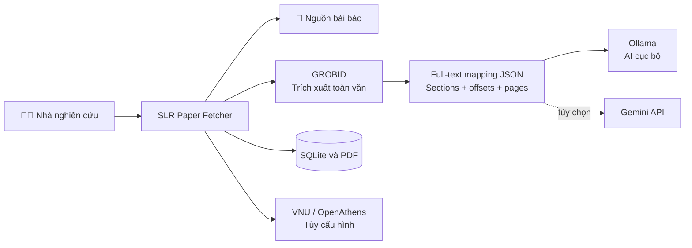

<div align="center">
  <h1>SLR Paper Fetcher</h1>
  <p><strong>Nền tảng hỗ trợ thu thập, quản lý và rà soát bài báo khoa học cho systematic literature review.</strong></p>
  <p>
    
    
    
  </p>
  <p>
    <a href="#docker">🚀 Cài bằng Docker</a> &nbsp;·&nbsp;
    <a href="#native">💻 Cài trực tiếp</a> &nbsp;·&nbsp;
    <a href="#features">✨ Khám phá tính năng</a>
  </p>
</div>

SLR Paper Fetcher nhận DOI, tải các bản PDF có thể truy cập, quản lý thư viện bài báo và tạo bản phân tích có thể truy ngược về văn bản nguồn. Ứng dụng kết hợp **GROBID** để trích xuất toàn văn với **Ollama** chạy cục bộ hoặc **Gemini API** để hỗ trợ phân tích.

> [!IMPORTANT]
> Kết quả AI là bản nháp phục vụ rà soát. Người nghiên cứu cần kiểm tra trích dẫn và nội dung nguồn; cấu trúc lập luận không tự chứng minh tính đúng đắn khoa học.

## 🧭 Mục lục

- [✨ Tính năng](#features)
- [🧩 Kiến trúc](#architecture)
- [🐳 Cài và chạy bằng Docker](#docker)
- [💻 Cài và chạy trực tiếp](#native)
- [🤖 Chọn AI provider](#ai-provider)
- [⚙️ Cấu hình](#configuration)
- [💾 Lưu trữ và sao lưu](#data)
- [🩺 Khắc phục sự cố](#troubleshooting)
- [🔗 Tài liệu tham khảo](#references)

<a id="features"></a>
## ✨ Tính năng

| | Khả năng | Mô tả |
|---|---|---|
| 🔎 | **Tìm và tải bài báo** | Nhận DOI đơn lẻ, danh sách DOI, CSV hoặc Excel; thử các nguồn truy cập mở và VNU/OpenAthens đã cấu hình. |
| 📚 | **Thư viện PDF** | Theo dõi trạng thái tải, quản lý tệp và xuất trích dẫn RIS. |
| ☁️ | **Đồng bộ SLR System** | Chọn dự án đích và gửi bài báo đã lưu qua API. |
| 🧠 | **Phân tích toàn văn** | Trích xuất nội dung bằng GROBID; phân tích bằng Ollama cục bộ hoặc Gemini API. |
| 🕸️ | **Rà soát lập luận** | Xem trích dẫn nguồn, mô hình 5 phần The Craft of Research, Toulmin Model và AIF Graph; rà soát các đề xuất AI. |
| 💾 | **Tiếp tục công việc** | Lưu bản phân tích, lịch sử và trạng thái hàng đợi trong SQLite. |

<a id="architecture"></a>
## 🧩 Kiến trúc



Trước khi gọi AI, GROBID tạo file `<tên-PDF>.fulltext.json` cạnh PDF. Pipeline đọc lại file này, kiểm tra toàn bộ section, offsets và độ dài văn bản; nếu GROBID chỉ trả về văn bản một phần hoặc mapping không hợp lệ thì dừng phân tích. Các section được chia thành chunk nhưng gửi đủ toàn văn; bản nháp được tổng hợp sau khi xử lý hết chunk.

<a id="docker"></a>
## 🐳 Cài và chạy bằng Docker

### Yêu cầu

- **Windows/macOS:** Docker Desktop đã cài và đang chạy.
- **Linux:** Docker Engine và Docker Compose plugin.
- Internet trong lần đầu để tải container images và Chromium.
- Dung lượng phù hợp cho Ollama model nếu chọn phân tích cục bộ.

### Bước 1 — Tạo cấu hình

Nếu chưa có `.env`, tạo từ mẫu:

**Windows · PowerShell**

```powershell
if (-not (Test-Path .env)) { Copy-Item .env.example .env }
```

**macOS · Linux**

```bash
[ -f .env ] || cp .env.example .env
```

Điền `VNU_LIBRARY_ID` và `VNU_LIBRARY_PASSWORD` trong `.env` nếu cần dùng quyền truy cập thư viện. Có thể để trống để bắt đầu với nguồn truy cập mở hoặc Gemini.

### Bước 2 — Khởi động ứng dụng

```bash
docker compose up --build -d
```

Mở **[http://localhost:8543](http://localhost:8543)**. Ứng dụng chỉ lắng nghe trên máy cục bộ theo mặc định.

### Bước 3 — Cấu hình AI

**Ollama · chạy cục bộ**

Tải model mặc định một lần:

```bash
docker compose exec ollama ollama pull qwen2.5:7b
```

**Gemini · API**

Mở **Settings**, chọn **Gemini API** và dán API key. Key được giữ trong cấu hình cục bộ của volume ứng dụng và không được trả lại cho trình duyệt.

### Lệnh Docker thường dùng

```bash
# Theo dõi log web app
docker compose logs -f web

# Dừng container, giữ nguyên volumes
docker compose down
```

Để đổi cổng host, thêm `WEB_PORT=9000` vào `.env`. Không dùng `docker compose down -v` nếu cần giữ database, PDF, browser profile và Ollama models.

<a id="native"></a>
## 💻 Cài và chạy trực tiếp

Cần **Python 3.10 trở lên**, **Node.js 22.12 trở lên** và npm. Bundle giao diện Toulmin được biên dịch bằng Vite trước khi chạy ứng dụng.

**Windows · PowerShell**

```powershell
python -m venv .venv
.venv\Scripts\Activate.ps1
npm ci
npm run build
python -m pip install -r requirements.txt
python -m playwright install chromium
if (-not (Test-Path .env)) { Copy-Item .env.example .env }
python app.py
```

**macOS**

```bash
python3 -m venv .venv
source .venv/bin/activate
npm ci
npm run build
python -m pip install -r requirements.txt
python -m playwright install chromium
[ -f .env ] || cp .env.example .env
python app.py
```

**Linux**

```bash
python3 -m venv .venv
source .venv/bin/activate
npm ci
npm run build
python -m pip install -r requirements.txt
python -m playwright install --with-deps chromium
[ -f .env ] || cp .env.example .env
python app.py
```

Mở **[http://127.0.0.1:8543](http://127.0.0.1:8543)**. GROBID và Ollama là các dịch vụ riêng; cập nhật `GROBID_URL` hoặc `OLLAMA_URL` trong `.env` nếu chúng chạy ở địa chỉ khác. Trên Windows, `run_app.bat` cũng cài frontend dependencies, build asset, cài Python dependencies và Chromium trước khi chạy.

<a id="ai-provider"></a>
## 🤖 Chọn AI provider

| Provider | Cần chuẩn bị | Cách bật |
|---|---|---|
| 🖥️ **Ollama** | Dịch vụ Ollama và model đã tải | Chọn Ollama trong **Settings**; Docker Compose dùng `qwen2.5:7b` mặc định. |
| ☁️ **Gemini API** | Gemini API key | Chọn Gemini trong **Settings** và nhập key. |

<a id="configuration"></a>
## ⚙️ Cấu hình

| Biến | Mặc định | Chức năng |
|---|---|---|
| `VNU_LIBRARY_ID`, `VNU_LIBRARY_PASSWORD` | Trống | Tài khoản thư viện VNU/OpenAthens. |
| `VNU_OPENATHENS_BASE_URL` | URL OpenAthens của VNU | Địa chỉ chuyển tiếp qua thư viện. |
| `GROBID_URL` | `http://127.0.0.1:8070` native | Dịch vụ trích xuất toàn văn. |
| `AI_DEFAULT_PROVIDER` | `ollama` | Provider phân tích mặc định. |
| `OLLAMA_URL` | `http://127.0.0.1:11434` native | Địa chỉ dịch vụ Ollama. |
| `OLLAMA_MODEL` | `qwen2.5:7b` | Tên model Ollama. |
| `GEMINI_API_KEY` | Trống | Gemini key; có thể nhập trong **Settings**. |
| `GEMINI_MODEL` | `gemini-2.5-flash` | Tên model Gemini. |
| `APP_HOST`, `APP_PORT` | `127.0.0.1`, `8543` | Host và cổng khi chạy native. |
| `DOWNLOAD_FOLDER` | `./downloads` | Nơi lưu PDF khi chạy native. |
| `SLR_API_BASE_URL` | `http://127.0.0.1:5000` | Địa chỉ SLR System. |
| `SLR_API_KEY`, `SLR_DEFAULT_PROJECT_ID` | Theo cấu hình | Một API client key của SLR; quyền project/kho/phân tích được quyết định bằng scope và project ID được cấp. |
| `SAFFRON_ENABLED` | `true` | Bật trích xuất term và taxonomy sau mỗi lần phân tích bài báo. |
| `SAFFRON_API_URL` | `http://127.0.0.1:8081` native | URL của runner SAFFRON. Trong Compose, dùng địa chỉ nội bộ `http://saffron:8080`. |
| `SAFFRON_GIT_REF` | `bcf009f176713ced1d707324043124670827125b` | Revision upstream đã dùng để build và xác minh term extraction. |
| `SAFFRON_TAXONOMY_MODEL_PATH` | `/opt/saffron/models/default.json` | Vị trí file SVM taxonomy đã train bên trong container SAFFRON; file này phải có trong volume `saffron-models`. |
| `SAFFRON_AUTO_START` | `true` | Ở chế độ chạy native, tự gọi Docker Compose để bật service nếu chưa sẵn sàng. |

Trong Docker Compose, web app truy cập GROBID tại `http://grobid:8070` và Ollama tại `http://ollama:11434`. Các giá trị AI trong **Settings** được lưu trong volume `app-data` và giữ nguyên sau khi container khởi động lại.

Để kết nối SLR System, dùng nút **Cấu hình API** trong ứng dụng. Backend phải truy cập được từ container; trên Docker Desktop, địa chỉ host thường dùng `http://host.docker.internal:<port>`.

### OpenAlex Topics in the Paper Library

The Paper Library uses the OpenAlex hierarchy (Domain → Field → Subfield → Topic) for classification filters and taxonomy sorting. It defaults to each work's primary topic so a paper appears once; enable secondary topics when broader recall is needed. **Update OpenAlex** backfills downloaded papers without a current hierarchy, persists the result locally in paper metadata and completed analysis drafts, and reports progress without rerunning AI or SAFFRON. This local backfill does not upload data to SLR-BE. Exact DOI matching is required; unavailable and unmatched works remain visible with their status.

The local API starts the backfill with `POST /api/openalex/backfill` and reports progress from `GET /api/openalex/backfill`. The POST returns `202` while work is running, `409` when another job is active, and `200` when no update is needed. Backfill only considers downloaded papers with valid local PDFs; it skips current, complete OpenAlex artifacts.

### SAFFRON 4.0 · term và taxonomy theo từng bài

The runner starts the official Term Extraction module REST application inside the isolated container. It returns a usable `PARTIAL` term result if no trained taxonomy model is available; with a compatible model mounted at `/opt/saffron/models/default.json`, it runs the official TAXO pipeline and returns the taxonomy as well.

**Taxonomy runtime prerequisite:** upstream SAFFRON's `-k TAXO` pipeline reads a trained SVM model from `/opt/saffron/models/default.json`. The pinned runtime has no model at that path, so provide a reviewed, compatible model in the `saffron-models` volume before expecting taxonomy output; the runner reports a clear unavailable status when it is absent. The upstream README's general first-run model-download note does not establish that a trained taxonomy classifier is included. Do not substitute a model trained on unrelated data or treat missing taxonomy as an empty taxonomy. Term extraction also omits SAFFRON's `weirdness` score because that feature requires a reference corpus, which a single-paper run does not have.

To produce that model, SAFFRON's upstream `taxonomy/train` command needs terms, document-term mappings, and gold `.taxo` hierarchy labels. The pinned checkout includes those inputs only for the `food_en` benchmark; that is not a reviewed fit for this SLR domain. A domain model needs representative reviewed labels before `-k TAXO` can be enabled as a completed result.

After obtaining a reviewed model file, copy it into the named volume with `docker compose cp .\default.json saffron:/opt/saffron/models/default.json`. The runner validates that it is JSON containing a non-empty `classifierData` field before starting TAXO.

An existing completed AI analysis can also rerun SAFFRON from the **Terms & Taxonomy** tab. This reuses a checksum-pinned full-text mapping, rejects legacy or stale mappings, and updates only `saffron_analysis`; it does not rerun or replace the AI draft.

Khi bật `SAFFRON_ENABLED`, sau khi bài báo được phân tích, Fetcher gửi riêng full text của bài đó tới service SAFFRON trong Docker. Service gọi CLI SAFFRON với taxonomy pipeline; output được chuẩn hóa thành các term candidate, taxonomy node/link và trích dẫn offset trỏ về full-text mapping của PDF. Kết quả nằm trong draft của bài báo và tab **Terms & Taxonomy**. Candidate do máy sinh cần được con người rà soát trước khi dùng làm filter. Bài không có ngôn ngữ hoặc không phải tiếng Anh được đánh dấu rõ; SAFFRON không làm hỏng kết quả phân tích chính nếu service lỗi.

Trong lúc phân tích từng bài, Fetcher tra OpenAlex Work theo DOI chính xác và lưu `openalex_classification` riêng trong analysis draft để xem primary topic, topic scores và hierarchy labels ngay trên màn hình bài báo. Khi upload, Fetcher gửi các canonical IDs qua metadata của analysis-runs API để SLR-BE lưu vào classification field đã có cho bộ lọc Repository. OpenAlex classification được giữ riêng với term candidates SAFFRON; nếu DOI không khớp hoặc OpenAlex không có phân loại, phân tích và upload vẫn tiếp tục.

Trong chế độ native, Fetcher kiểm tra `http://127.0.0.1:8081/health` rồi chạy `docker compose up -d saffron` khi cần. Trong chế độ Compose, web app gọi service qua `http://saffron:8080`; cấu hình này không cần Docker socket bên trong container web. Lần build đầu cần tải source SAFFRON và Maven dependencies, nên có thể mất vài phút và cần đủ RAM. Image dùng Java 17 theo yêu cầu của upstream hiện tại. Xem trạng thái bằng `docker compose ps saffron` và log bằng `docker compose logs -f saffron`. Có thể kiểm tra health của Fetcher tại `/api/saffron/health`.

<a id="data"></a>
## 💾 Lưu trữ và sao lưu

| Nội dung | Chạy native | Docker Compose |
|---|---|---|
| Database và phân tích | `data/papers.sqlite3` | Volume `app-data` |
| PDF đã tải | `downloads/` | Volume `paper-downloads` |
| Cấu hình Settings | `.env` | File cấu hình trong volume `app-data` |
| Browser profile | `.vnu-browser-profile/` | Volume `browser-profile` |
| Ollama models | Theo cấu hình Ollama | Volume `ollama-models` |
| SAFFRON models | `SAFFRON` Docker image/cache | Volume `saffron-models` |

Dữ liệu native và Docker tách biệt, không tự đồng bộ. Sao lưu thư mục hoặc volumes tương ứng trước khi chuyển máy.

<a id="troubleshooting"></a>
## 🩺 Khắc phục sự cố

| Vấn đề | Cách xử lý |
|---|---|
| Ollama báo thiếu model | Chạy `docker compose exec ollama ollama pull qwen2.5:7b` hoặc tải model đang chọn. |
| Không kết nối GROBID | Kiểm tra `docker compose ps` và `docker compose logs grobid`. |
| SAFFRON báo unavailable | Bật Docker Engine, kiểm tra `docker compose ps saffron`, `docker compose logs saffron`, và URL `SAFFRON_API_URL`; native mode cần Docker Compose CLI. |
| SAFFRON trả về ít term hoặc taxonomy rỗng | SAFFRON phân tích một bài mỗi lượt; taxonomy có thể rỗng với ít nội dung hoặc bài không phù hợp. Xem trạng thái và evidence trong tab **Terms & Taxonomy**. |
| Cổng 8543 đang được dùng | Đổi `WEB_PORT` trong `.env`, rồi khởi động lại Compose. |
| Cần xác minh CAPTCHA thủ công | Docker chạy Chromium headless; chạy native để mở cửa sổ browser tương tác. |
| Chạy trên máy ARM | Image GROBID CRF hiện nhắm tới `linux/amd64`; giả lập có thể chậm hơn. |
| Không tìm thấy PDF | Khả năng truy cập tùy nguồn mở hoặc quyền thư viện đã cấu hình. |

<a id="references"></a>
## 🔗 Tài liệu tham khảo

- [GROBID · Docker](https://github.com/grobidOrg/grobid/blob/master/doc/Grobid-docker.md)
- [Ollama · Docker image](https://github.com/ollama/ollama#docker)
- [Playwright Python · Docker](https://playwright.dev/python/docs/docker)
- [Docker Compose · Quickstart](https://docs.docker.com/compose/gettingstarted/)
