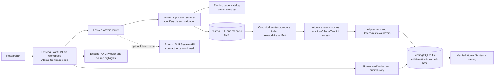

# Atomic Sentence Integration — Proposed Architecture

**Status:** Proposal for integration into the existing SLR Paper Fetcher. This document describes boundaries and responsibilities; it does not authorize or perform code or schema changes.

## Architectural decision

Add Atomic Sentence as a separately versioned feature module inside the existing FastAPI application. Keep `app.py` as the application composition point, but put Atomic route handlers, schemas, orchestration, and validation in a small dedicated package (for example, `atomic_sentence/`). The module shares the existing paper catalog, validated PDF, GROBID full-text mapping, AI provider configuration, SQLite database file, and PDF viewer. It owns its sentence-level run state, annotations, verification history, and library query behavior.

Do not replace or fork paper acquisition, GROBID, the analysis queue, current paper-analysis output, SAFFRON, OpenAlex, Toulmin/AIF, or the SLR System integration. Atomic results remain additive and independent of existing analysis drafts.

## Proposed component view

## Responsibilities by layer

### Frontend

- Add one navigation entry and one Atomic Sentence workspace within the existing sidebar/page conventions. Keep current search, download, repository, analysis, and settings pages and workflows intact.
- Let the researcher select an already downloaded paper from the existing library. If a future requirement adds direct file upload, route it through the current paper/file validation and persistence boundary rather than implementing a second file store.
- Present candidates beside the source PDF. Display the exact source sentence, sentence/paragraph/section context, page and highlight where available, and clearly separate source wording from generated atomized or context-completed wording.
- Render hedge markers and scopes, stance, engagement, and metadiscourse labels with text labels and accessible controls. Allow reviewers to inspect model rationale and AI precheck warnings without presenting scores as calibrated probabilities.
- Provide explicit human actions (for example, verify, reject, needs revision) with reviewer identity/ID, optional rationale, and a visible decision history. A candidate is not in the library until a human verifies it.
- Add a library view/filter for verified items with paper/source links and version/staleness indicators. Reuse existing visual conventions and PDF access; the initial feature does not need another graph renderer.

### Backend

- Keep FastAPI and existing API conventions. Mount a separate Atomic router from `app.py`; keep route logic thin and call Atomic services for state transitions and validation.
- Reuse `paper_store` paper lookup, DOI normalization, saved-file checks, and the existing analysis/detail routes where they fit. Atomic paper listing should be a view over papers with usable local sources, not a duplicate catalog.
- Introduce an independent Atomic run lifecycle with explicit stages/statuses and retryable errors. It can follow the existing background queue pattern, but should not overwrite `paper_analyses` or block/relabel the existing paper-analysis run. Pilot concurrency and worker lifecycle before deciding whether to share scheduling code.
- Validate each request against the paper ID, source file, mapping version, and checksum. Reject or mark stale any analysis whose source PDF or mapped text no longer matches its recorded identity.
- Expose read, run, candidate, review, and verified-library operations through versioned request/response schemas. Keep IDs and statuses stable; return structured validation warnings and safe errors.
- Keep optional SLR System export behind a later adapter. The current upload contract cannot be assumed to accept Atomic-specific entities.

Suggested endpoint family (illustrative; final API contract follows the PRD):

| Operation | Example route | Purpose |
|---|---|---|
| List eligible local papers | `GET /api/atomic/papers` | Reuse saved papers and report source/mapping readiness. |
| Start or retry a run | `POST /api/atomic/runs` | Create an idempotent run against one paper and exact document version. |
| Read run and stages | `GET /api/atomic/runs/{run_id}` | Return run status, versions, warnings, and candidate counts. |
| Read candidate set | `GET /api/atomic/runs/{run_id}/candidates` | Return source-linked candidate and annotation records. |
| Review a candidate | `POST /api/atomic/candidates/{candidate_id}/decisions` | Append a human decision and optional correction/rationale. |
| Search verified library | `GET /api/atomic/library` | Return only verified, non-stale entries, with provenance and filters. |

### PDF processing and provenance

- Reuse the saved validated PDF and its adjacent checksum-pinned `.fulltext.json` generated by the current GROBID path.
- Build a deterministic sentence index from the mapping’s existing text and hierarchy. Store sentence/paragraph/section IDs, order, exact source quote, absolute offsets in the declared mapping text, and page spans when available. Keep the raw mapped text and PDF as immutable source artifacts.
- Record the source PDF SHA-256, full-text mapping schema/version and checksum, segmentation implementation/version, and normalized text hash on each Atomic document version/run. Do not treat a DOI alone as sufficient provenance.
- Attach all annotations to source spans or stable source unit IDs. When an exact span cannot be mapped, retain the candidate as unresolved/partial for review; never invent a page or offset.
- Reuse the PDF endpoint/viewer and existing highlight patterns. PDF coordinates are not guaranteed for all text; text quote and section/paragraph anchors remain the fallback.
- Surface extraction failures, low coverage, unsupported language, missing mapping, or stale checksums explicitly. The repository has no configured OCR pipeline.

### AI processing

Keep Atomic stages independent and individually versioned. A proposed pipeline is:

1. **Input readiness and canonicalization:** validate PDF/mapping identity; segment mapped text into stable source sentences and preserve boundaries.
2. **Candidate extraction:** select sentence candidates with exact evidence anchors. Keep selection status separate from final verification.
3. **Linguistic annotations:** detect hedge markers and resolve their scope; annotate stance, engagement, and metadiscourse using the agreed annotation scheme. Preserve label evidence and model/prompt provenance.
4. **Semantic atomization:** propose one or more standalone semantic statements linked to the exact source sentence(s); retain original sentence text unchanged.
5. **Context completion and validation:** if a standalone statement needs a referent, condition, antecedent, or other context, link each completion to supporting source spans and flag generated wording. Validate source support, scope, and meaning preservation.
6. **AI precheck:** report machine-checkable issues and model suggestions (span mismatch, missing antecedent, over-broad scope, unresolved label, etc.). Precheck is advisory and cannot verify/publish.

Reuse existing Ollama/Gemini configuration and structured JSON response utilities where compatible. Use dedicated Atomic schemas/prompts and version fields; do not silently change the current analysis prompt or its run behavior. Prefer deterministic validation for IDs, offsets, quote matching, required fields, and status transitions; use AI for linguistic interpretation that cannot be reliably derived from rules alone. Keep scores labeled with their method and do not call them calibrated confidence without evaluation.

### Database and file storage

- Keep using the existing SQLite file, `paper_store.py` connection/transaction conventions, and configured persistent app-data volume for the initial version. Keep large source artifacts and PDFs on the existing filesystem volume.
- Represent Atomic runs, source sentence units, candidates, annotations, context links, precheck results, and verification decisions as additive data. Use Atomic-specific records where existing `scientific_propositions` or `review_decisions` semantics do not match.
- Do not add schema in this task. Before implementation, settle logical entities, uniqueness/version rules, migration/rollback expectations, indexing, and whether some high-volume stage output should be JSON artifacts rather than normalized rows.
- Derive Verified Atomic Sentence Library membership from a current human verification decision and a current source document version. If a PDF/mapping changes, mark prior entries stale or superseded; do not silently keep them eligible.
- Treat project/work IDs as optional links to the current external SLR System. The local Fetcher currently has a workspace-level SQLite store, not a separate local project database.

### Human verification

- Human verification is the publication gate. The pipeline can create candidates, annotations, atomized text, and precheck warnings, all explicitly pending.
- Record reviewer ID/name, decision, timestamp, rationale, item/version references, and before/after data when a reviewer edits text or labels. Keep a history; do not overwrite the source quote or erase prior decisions.
- Define whether one reviewer is sufficient, whether a second reviewer/adjudication is needed, and whether editing requires re-verification in the Atomic requirements contract.
- Make the library query return only `verified` items tied to the current source version and accepted by the required review policy.

## Integration boundaries and compatibility

- The Atomic module consumes existing paper records and full-text artifacts; it does not acquire duplicate PDFs or metadata.
- Existing `/api/analysis/*` runs remain available and keep their current payload contract. Atomic-specific output should be queried through Atomic routes and persisted separately.
- Existing Toulmin/AIF graphs and proposition/relation identifiers remain authoritative for their own use cases. Atomic sentences may link to proposition IDs if useful, but must not equate sentence atomization with argument role extraction.
- The existing `/api/slr/push-papers` path may continue to upload supported paper/analysis artifacts. Atomic synchronization requires a separate confirmed contract and should fail independently of local review.
- New dependencies are not justified at architecture stage. First evaluate sentence segmentation and linguistic tooling against the source data and existing runtime; add a dependency only if a measured gap cannot be addressed with the current stack.

## Rollout and quality gates

1. Obtain the Atomic PRD and research basis, then write the label/decision contract and a small adjudicated evaluation set.
2. Approve the logical data model and additive migration plan; keep old runs readable and unaffected.
3. Implement document-version and sentence-source indexing, then verify exact round-trip spans and stale-source behavior.
4. Add independent run orchestration and AI stages, starting with candidate extraction and one linguistic label set; do not publish from AI output.
5. Add the review UI and verified library only after candidate/source evidence can be inspected and decision history is durable.
6. Evaluate quality, coverage, disagreement, stale rates, and runtime before expanding labels, languages, paper volumes, or remote synchronization.

See [`atomic-sentence-data-model.md`](atomic-sentence-data-model.md) for proposed entities and [`atomic-sentence-implementation-plan.md`](atomic-sentence-implementation-plan.md) for tasks and acceptance criteria.
