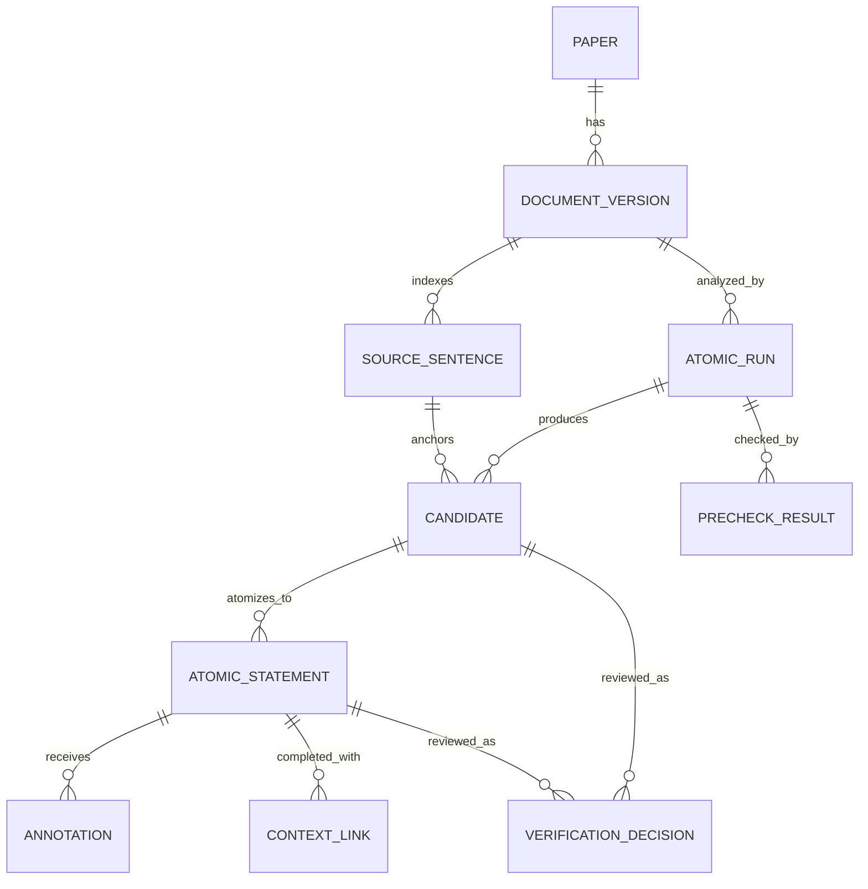

# Atomic Sentence Integration — Proposed Data Model

**Status:** Logical proposal only. It does not create or alter SQLite tables. Final field names and relationships depend on the missing Atomic Sentence PRD and annotation policy.

## Design goals

1. Reuse the existing paper record, local PDF, and GROBID full-text mapping as the canonical source artifacts.
2. Preserve original text and its provenance separately from machine-generated sentence candidates, atomized statements, and context completions.
3. Make every annotation and review decision traceable to a precise document version and source span.
4. Keep machine state, automated precheck, and human verification distinct.
5. Make the Verified Atomic Sentence Library a view of verified, current entries rather than a second untraceable copy of paper text.
6. Keep this model additive to the existing SQLite-backed application. No schema change is part of this task.

## Relationship overview

`PAPER` above is the current Fetcher paper record, not a proposed duplicate table. This diagram shows logical entities; an implementation may store some low-volume structures together in versioned JSON artifacts, while query-heavy review and library data may need normalized tables.

## Existing records and artifacts to reuse

| Existing record/artifact | Current purpose | Atomic Sentence use |
|---|---|---|
| `papers` row in `paper_store.py` | DOI-keyed local paper/file registry, metadata, provider/source, current status | Canonical paper identity and existing file path. Preserve current metadata and download lifecycle. A `slrwork_...` source can have no DOI, so use the current paper ID, not DOI alone. |
| Local PDF | Validated downloaded source | Immutable source artifact for review and PDF display. Identify by SHA-256; do not store a generated rewrite over it. |
| `<pdf>.fulltext.json` | Versioned GROBID full-text mapping, text, section/paragraph structures, offsets/page spans, PDF checksum | Input for canonical sentence segmentation, candidate evidence, and source-to-PDF navigation. Treat the exact mapping as a source artifact. |
| `analysis_runs` / `source_sections` | Versioned current paper-analysis runs and sections | Reuse as architectural precedent. Atomic semantics should not be inserted into these tables unless their constraints are proven to fit. |
| `scientific_propositions` | Source-grounded/inferred propositions with quote, span, provenance, and review state | May be linked as related evidence or an upstream context item. It is not itself a sentence-level Atomic record. |
| `review_decisions` and other review tables | Decisions and reviewer history for existing analysis objects | Reuse audit conventions. Reuse the table only if its item-type validation and lifecycle support Atomic decisions; otherwise create Atomic-specific review records later. |

## Proposed logical entities

### 1. Paper reference

Use the existing paper identifier. Store no duplicate title/author/PDF catalog in the Atomic module. A run may snapshot display metadata for reproducibility, but it should retain a reference to the current paper row and the exact file artifact.

Recommended references: `paper_id` (canonical current key), optional normalized `doi`, optional external SLR project/work ID. Project/work linkage is nullable and must not be mistaken for an existing local project table.

### 2. Document version

An immutable identity for the text analyzed by Atomic processing. This is needed because the same DOI may have a replacement PDF, a re-extracted mapping, or a changed sentence segmenter.

| Field | Meaning |
|---|---|
| `document_version_id` | Stable identifier for the exact source and extraction/segmentation snapshot. |
| `paper_id` | Reference to the existing paper. |
| `source_pdf_sha256` | Hash of the validated PDF used for extraction. |
| `fulltext_mapping_sha256` | Hash of the exact mapping artifact read by the run. |
| `mapping_schema_version` | Version of the GROBID mapping contract. |
| `text_sha256` | Hash of the exact text representation used for sentence boundaries and offsets. |
| `text_representation` | Explicit value such as `mapping.full_text`; offsets are not ambiguous between PDF, TEI, Markdown, or normalized text. |
| `segmenter_name/version` | Deterministic sentence segmentation implementation and version. |
| `created_at`, `warnings` | Snapshot time and extraction/segmentation warnings. |

Changing the PDF, mapping, text normalization, or sentence boundaries creates a new version. Dependent candidates and library entries tied to an older version become stale until reprocessed or explicitly retained as historical.

### 3. Source units

Canonical section, paragraph, and sentence units derived from the mapping. Sections and paragraphs already exist in the full-text mapping; the new requirement is a deterministic sentence index with offsets into the exact `text_representation` above.

| Field | Meaning |
|---|---|
| `source_unit_id` | ID scoped to `document_version_id`; includes unit type or points to a typed unit. |
| `unit_type` | `section`, `paragraph`, or `sentence`. |
| `parent_unit_id`, `ordinal` | Hierarchy and order within the parent. |
| `text` | Exact source substring, not a normalized or AI-edited version. |
| `start_offset`, `end_offset` | Half-open offsets `[start, end)` in the declared mapping text; nullable only when no faithful mapping exists. |
| `page_spans[]` | Zero or more source page spans from GROBID; may be empty. |
| `source_status` | For example `mapped`, `partial`, or `unresolved`, with reason when needed. |

Offsets and quotes must be checked against the original mapping text. A failed round-trip is a validation error, not an invitation to guess a nearby location.

### 4. Atomic run

One independent processing attempt against one document version. It should not share completion state with the current `paper_analyses` record.

Suggested fields: `atomic_run_id`, `paper_id`, `document_version_id`, `status`, `stage`, `created_at`, `started_at`, `completed_at`, `error_code`, and `warnings`. Store `provider`, `model`, extraction/prompt/schema versions, configuration hash, and stage versions in a reproducibility/provenance object. Include an idempotency key or equivalent where retry behavior requires it.

Run status and module/stage status must distinguish not run, running, complete, partial, failed, and stale. Retrying one stage must not silently replace verified decisions from a previous run.

### 5. Candidate source sentence

An AI-selected source candidate, tied to one or more exact source sentence units. It represents selection and source evidence, not a human-approved library entry.

Suggested fields: `candidate_id`, `atomic_run_id`, `source_sentence_ids[]`, `source_quote`, absolute `source_span` (and page spans when available), candidate rationale, selection status, and provenance. The original source quote is immutable. A candidate may be rejected or marked uncertain without deleting its anchor.

### 6. Atomic statement

One proposed standalone semantic statement derived from a candidate. A candidate can produce zero, one, or multiple statements. Keep the verbatim quote and proposed statement separate.

Suggested fields: `atomic_statement_id`, `candidate_id`, `text`, `statement_kind` (to be defined in the PRD), source sentence/span links, parent/candidate relationship, semantic completeness state, and generation provenance. If a rewrite contains words not present in its source quote, those words are generated content and require an explicit transformation/context record and reviewer visibility.

Do not assume a universal atomicity taxonomy or classify by a hard-coded model score before the research/PRD contract defines one.

### 7. Annotation

Versioned machine annotations attached to a candidate, statement, or specific source span. Store annotations as typed records or a versioned JSON structure with equivalent traceability.

An annotation should include: `annotation_id`, `target_id`, `target_type`, `label_family`, `label`, optional source `marker_span`, optional `scope_span`, optional `scope_target_id`, `rationale/evidence`, `status`, and provenance (`provider`, `model`, `prompt_version`, schema/version, timestamp). Label families cover hedge and hedge-scope, stance, engagement, and metadiscourse. Their category sets must be specified by the PRD/research protocol.

Keep marker location distinct from hedge scope. A detected hedge marker is not sufficient evidence that its scope was resolved correctly. Annotation edits create a new version or an auditable change rather than erasing model output.

### 8. Context link and completion

Represents source context used to make an atomic statement understandable outside its original sentence. Keep source context separate from generated completion.

Suggested fields: `context_link_id`, `atomic_statement_id`, context `source_unit_id`/span, exact supporting quote, `completion_text`, completion type, rationale, and status. Validation must identify which words/concepts are source-supported, which are referential substitutions or generated connective language, and any unresolved antecedent or condition. The source sentence is never replaced by the completed wording.

### 9. AI precheck result

Machine-generated validation findings for a run or item. Suggested fields: `precheck_id`, `target_id`, `check_name/version`, `result` (`pass`, `warning`, `fail`, `not_assessed`), explanation, implicated spans/IDs, and provenance. Include deterministic checks such as quote/offset round-trip, required links, version consistency, and schema validity, plus clearly labeled AI checks for semantic completeness or unsupported additions.

`pass` means only that specified checks passed. It never means that a researcher verified the entry or that the statement is scientifically true.

### 10. Verification decision

Append-only human review event for a candidate, statement, or annotation. Suggested fields: `decision_id`, target ID/type, source/document version, reviewer ID/name, decision (`verified`, `rejected`, `needs_revision`, or PRD-defined equivalent), rationale, timestamp, and optional before/after snapshot. Multiple decisions can be retained for adjudication and history.

The current review state should be derived using the agreed review policy, not by assuming that the latest arbitrary database write is authoritative. An edit after verification should either create a new item version requiring review or explicitly revoke the prior verification.

### 11. Verified Atomic Sentence Library entry

The library should expose only entries satisfying the agreed human verification policy and tied to the current source version. Prefer a query/view over the Atomic statement plus its verification record rather than duplicating text into a disconnected library table. A materialized index can be added later if search performance requires it.

Library results should include the statement, original quote, paper metadata, source/page link, annotation summary, verification provenance, current/stale state, and relevant run/document versions. Rejected, pending, stale, or superseded items remain available in run history but are excluded from the default verified library.

## Provenance and lifecycle invariants

- Every source quote resolves to a source sentence/span in one immutable document version, or is explicitly marked unresolved.
- Every offset states its text representation and uses one convention (recommended half-open offsets). Quote equality is checked against the mapped text.
- Every generated rewrite links back to the source sentence(s); context completion cites supporting context spans and distinguishes generated text.
- Every AI output records the model/provider and prompt/schema/config versions needed to understand how it was produced.
- Automated precheck and human verification are distinct state dimensions. Precheck cannot set the verified state.
- Reviewer decisions and edits retain history and the item/source version they judged.
- Source hash, mapping hash, or segmentation version changes make dependent evidence stale; the library excludes stale entries until reviewed against the new source.
- No Atomic process mutates the PDF, full-text mapping, or existing AI-analysis draft.

## Migration boundary

No database tables, indexes, or columns are proposed for creation in this task. When implementation is approved, use the existing SQLite file and make an additive, versioned migration through the `PaperStore` initialization/migration path. Decide whether source units and annotations belong in normalized tables or versioned artifacts after measuring expected corpus size and library query needs. Preserve old papers and current `analysis_runs`, and verify backup/rollback and old-run readability before deploying any migration.
