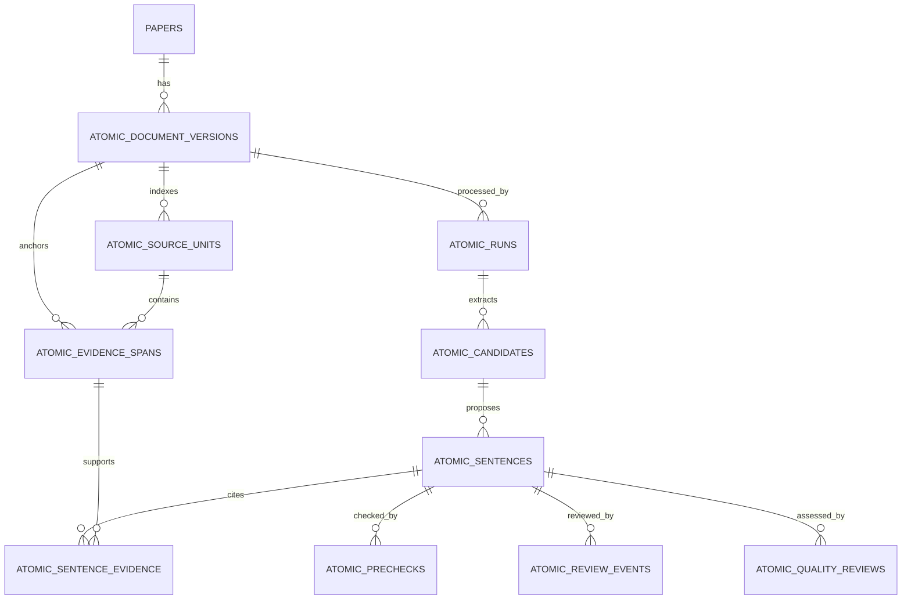

# AS-TECH-01 — Additive Database Design Proposal

**Status:** Logical design alternatives for review. No schema is selected or approved.
**Storage target:** Existing SQLite database managed by `PaperStore`.
**Scope guard:** No DDL, migration, application storage change, or alteration of existing table semantics is included.

## Design goals

1. Reuse the existing `papers` row and on-disk source artifact; do not duplicate paper records or PDFs.
2. Preserve immutable identity for the PDF, validated GROBID mapping, normalized source text, and segmenter/tokenizer used to create source units.
3. Keep extracted source wording and AI-proposed wording in separate records and fields.
4. Preserve exact offsets, evidence spans, source lineage, candidate lineage, provider/model/prompt provenance, human review identity, and append-only review history.
5. Make stale-source detection explicit and prevent an old review from silently transferring to a changed source.
6. Keep Atomic records separate from `analysis_runs`, `scientific_propositions`, `argument_relations`, and current analysis review tables.
7. Make any later migration additive, transaction-safe, idempotent, and reversible with a documented backup/rollback path after AS-DATA-001 approval.

## Proposed logical entities

The names below are logical names for discussion, not selected SQL identifiers or a final schema. The normalized form makes relationships and constraints inspectable. A versioned artifact representation may also be considered under AS-DATA-001, but it must satisfy the same provenance and query needs.

| Logical entity | Proposed responsibility and important fields |
|---|---|
| `atomic_document_versions` | One immutable source snapshot per existing paper key. `paper_key` FK to `papers.doi`; version ID; PDF SHA-256 and size; mapping path/artifact digest if computed; mapping schema version; full-text digest and character length; extraction completeness/warnings; captured time. No PDF copy. |
| `atomic_source_units` | Version-scoped structural/source units: unit ID, document version, parent section/paragraph IDs, unit kind, stable order, exact start/end offsets, exact source text or exact source slice, page/page spans, source-mapping references, segmenter ID/version where sentence units exist. Section and paragraph records can be imported as source units so the hierarchy is traversable. |
| `atomic_runs` | One independent Atomic processing run. Paper key and document-version FK; status/stage; provider/model; prompt, schema, segmenter and validator versions; request/idempotency key; timestamps; errors and structured provenance. It must not reuse current `analysis_runs` status. |
| `atomic_candidates` | Candidate extraction result tied to a run and one or more source-unit/evidence references. Candidate ID, exact source sentence/evidence, state, role/origin proposals, confidence/explanations where approved, and stable lineage. Zero/one/many candidates per paragraph must be representable. |
| `atomic_sentences` | A proposed statement/version. Stable AS ID/version; candidate and run lineage; proposed text; word count and tokenizer identity; proposed role and evidence origin; context/qualifier metadata; lifecycle projection derived from review history. Material regeneration or edit creates a linked version, not an in-place overwrite. |
| `atomic_evidence_spans` | A source-anchored span tied to document version and source unit. Exact quote, start/end offsets in the canonical mapped full text, page/page spans if available, anchor kind, and validation outcome. Distinguish primary claim-support spans from context spans. |
| `atomic_sentence_evidence` | Many-to-many link between AS version and evidence span, with link purpose such as primary support or context. Final cardinality remains subject to AS-OD-10. The proposal supports one or more links without making a cardinality policy final. |
| `atomic_prechecks` | Versioned deterministic and advisory findings for an AS version: evidence/hash/offset checks, word-count result, schema result, numeric/unit/comparison/qualifier findings, source freshness, and optional advisory explanation. Never contains a human verification event or authority to set VERIFIED. |
| `atomic_review_events` | Append-only human actions: AS version, action, note/reason, trusted principal ID, authorization context, event time, document-version reviewed, and request/idempotency key. No default reviewer identity. Only an authorized human review service can append VERIFY/REJECT events. |
| `atomic_quality_reviews` (conditional) | Quality assessment fields with immutable rubric/version provenance and reviewer event linkage. Keep generic until the official SPS appendix and AS-OD-09 decisions are available; do not create guessed dimensions, weights, or an official score. |

The minimum normalized set is document versions, source units, runs, candidates, AS versions, evidence spans/links, prechecks, and review events. Quality review is a conditional extension because the PRD requires it while the SPS rubric is unresolved.

## Entity relationships

`PAPERS` is the existing catalog table, not a new Atomic catalog. The diagram describes proposed logical relationships only.

## Integrity and versioning proposal

- Every record resolves to an existing canonical paper key and an immutable Atomic document-version ID.
- A source version records the saved PDF SHA-256/size and validated mapping schema version. A mapping artifact digest and extracted-text digest may be calculated for stronger change detection without modifying the mapping file.
- Every source span has a declared offset unit and source text representation. The service validates that `full_text[start:end] == quote` and that section/paragraph ranges agree with the mapping before persistence.
- A new PDF, mapping content, completeness result, text-normalization rule, or sentence segmenter version creates a distinct source/index version. Old versions remain auditable. Whether previously verified items become stale, superseded, or eligible for re-anchoring is unresolved under AS-OD-14.
- Candidate, sentence, source-unit, evidence-span, precheck, prompt, model, schema, segmenter and tokenizer identities are versioned or snapshotted sufficiently to reproduce the decision path.
- Unique/idempotency keys must scope a processing request to the source-version and pipeline-version tuple. Database constraints must reject cross-paper or cross-version evidence links.
- Review events are append-only. Current status is a projection of valid events under the approved lifecycle; AI run/precheck rows cannot write or imply a `VERIFIED` state.
- Deleting a paper or source artifact needs an explicit retention policy; cascading deletion must not silently erase an audit record. This policy needs Product Owner/security review.

## Index/search and export support

After scope approval, indexes may cover `(paper_key, source_version)`, section/order, run/status, candidate/AS lifecycle projection, role/origin, evidence version and review time. Search should query Atomic text and approved paper metadata through the existing paper key rather than duplicate author/year/title catalog values. SQLite FTS is an implementation alternative for later review; it is not selected here.

JSON/CSV exports should be assembled from a consistent read snapshot and include source paper key/metadata, AS version and text, role/origin, current approved review state, source quote/offset/page, source checksum/mapping version, evidence IDs, run/candidate lineage, reviewer identity/time, and rubric provenance when applicable. Export filters and library eligibility must follow the approved library contract. Pending/rejected/stale records must not be presented as verified.

## Decisions that block schema selection

| Decision | Schema impact | Current status |
|---|---|---|
| AS-OD-01/02 | Required reviewer quorum, state/event types, revision action | OPEN; Product Owner outcome missing |
| AS-OD-03/04/05/06/07/08 | Role taxonomy and any optional linguistic annotations | OPEN; Product Owner outcome missing; advanced annotations remain outside the proposed MVP unless approved |
| AS-OD-09 | Quality review fields, rubric identity, score projection | OPEN; Product Owner plus Research Lead review/approval requested |
| AS-OD-10 | Evidence link cardinality and primary/context semantics | OPEN; Product Owner outcome missing |
| AS-OD-11 | Language eligibility and tokenizer/word-count version | OPEN; Product Owner outcome missing |
| AS-OD-12 | Principal ID, authorization snapshot, reviewer attribution | OPEN; Product Owner outcome missing and identity source not established |
| AS-OD-13 | Origin values, citation markers, library treatment | OPEN; Product Owner outcome missing |
| AS-OD-14 | Stale/superseded/re-anchored version behavior | OPEN; Product Owner outcome missing |
| AS-OD-15/16 | Gold-set, adjudication, metric/evaluation records | OPEN; Product Owner and Research Lead review/approval requested |
| AS-OD-17 | Whether PRD thresholds are pilot observations or release gates | OPEN; Product Owner outcome missing |

The Product Owner has not approved any decision in QA-04/QA-05. Research decisions AS-OD-09, AS-OD-15, and AS-OD-16 remain OPEN pending Research Lead review, as requested. QA-05 records all 17 as OPEN.

## Relationship to canonical tickets

This design note supports review of **AS-DATA-001**, whose backlog status remains BLOCKED. It does not complete AS-DATA-001 or AS-GOV-002 and does not authorize migrations. AS-DATA-002 and AS-SRC-001 remain BLOCKED. The backlog currently lists AS-DATA-002 as depending on an AS-SRC-001 contract and AS-API-002, while AS-SRC-001 itself depends on AS-DATA-002 and AS-API-002. Before implementation, resolve that dependency wording without changing the canonical ticket IDs: agree whether “contract” means a reviewed interface/fixture contract rather than completed predecessor implementation, then sequence source indexing and API integration accordingly.

## Migration and rollback are future work

No migration file or SQL was created. When permitted by the approved design, a separate implementation ticket must specify a backup, schema-version marker, idempotent initialization, foreign-key and transaction handling, behavior with existing databases, rollback/recovery, and regression coverage. Existing rows and existing business logic must retain their meanings.
