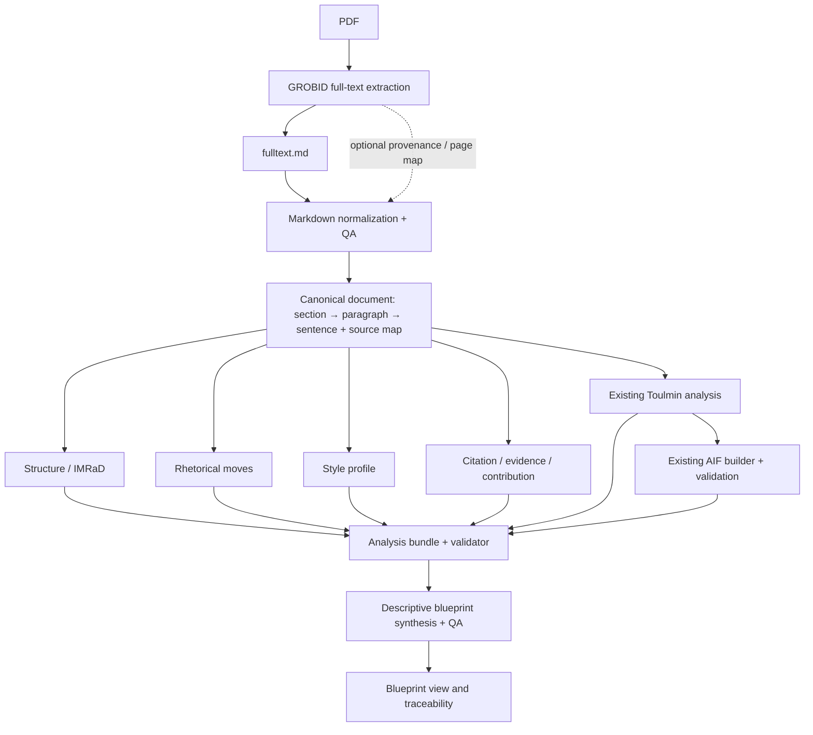

# Blueprint đề xuất: từ AI Toulmin/AIF hiện tại tới Scientific Paper Blueprint

> **Trạng thái:** Bản đề xuất để brainstorm, chưa phải quyết định triển khai.
> **Mục tiêu:** Mở rộng phân tích một bài báo thành blueprint mô tả cách bài báo được tổ chức, lập luận và trình bày; giữ Toulmin và AIF hiện tại làm đầu ra hạng nhất.

## 1. Đọc hiện trạng

Luồng code hiện tại trong `ai_analysis.py` là PDF → GROBID TEI → section có heading, text, offsets và page spans → AI review draft + proposition extraction → role/relation annotation → warrant reconstruction → unified argument payload → AIF graph. Toulmin cards được dựng từ propositions/relations theo quy tắc, còn graph AIF là cấu trúc riêng. `paper_store.py` lưu run, section, proposition, relation, AIF node/edge và `analysis_payload` trong SQLite. UI hiện có các màn Toulmin, AIF, propositions, evidence và review.

Đây là mô tả implementation hiện tại, nhưng chưa khớp nguyên tắc đầu vào của blueprint: trước khi phân tích, GROBID phải trích xuất **full text** thành `fulltext.md`; mọi phân tích nội dung phải bắt đầu từ file Markdown toàn văn đó.

Các nền tảng có thể tái sử dụng:

- `ai_analysis.py`: GROBID section extraction, source quotes, offsets, page mapping, provenance, prompt versions, JSON checks, Toulmin derivation, AIF builder/validator.
- `paper_store.py`: versioned analysis runs, persisted source sections and argument data, review history, legacy-card re-derivation.
- `templates/analysis.html` và `frontend/toulmin-graph/`, `frontend/aif-graph/`: hai graph views đã tách biệt; giữ adapters và graph contracts ổn định.

Khoảng trống so với tài liệu blueprint:

- Code hiện parse TEI trực tiếp và chưa materialize `fulltext.md`; cần bổ sung bước GROBID full-text extraction → Markdown trước các analyzer.
- Section hiện giữ văn bản paragraph-joined và page spans, nhưng chưa có canonical paragraph/sentence tree với ID ổn định và source map riêng.
- Chưa thấy các analyzer structure/IMRaD, rhetorical moves, writing style, citation-pattern và blueprint synthesis.
- AIF/Toulmin đã có, nên phần argument trong blueprint nên tham chiếu chúng thay vì tạo một pipeline lập luận thứ hai.

## 2. Quyết định hướng đi được đề xuất

Mở rộng theo kiểu **additive** nhưng chốt lại hợp đồng đầu vào: PDF → GROBID full-text extraction → `fulltext.md` → normalization/QA → canonical document → các analyzer. Mọi phân tích nội dung (bao gồm Toulmin/AIF) đọc từ cùng bản Markdown toàn văn đã chuẩn hóa và source map; cuối cùng tổng hợp thành `descriptive_blueprint` có liên kết ngược tới section, paragraph, sentence, proposition, relation và AIF node.

`fulltext.md` là artifact đầu vào chuẩn, không phải adapter tùy chọn. Có thể giữ TEI thô và metadata của GROBID làm provenance hoặc hỗ trợ source mapping, nhưng không để các analyzer đọc TEI song song với Markdown vì sẽ tạo hai cách diễn giải/offset khác nhau. Nếu TEI là payload GROBID sẵn có, một bước chuyển đổi xác định phải ghi ra `fulltext.md` trước khi phân tích.

Nguyên tắc thiết kế:

1. Toulmin và AIF hiện tại tiếp tục là nguồn chuẩn cho argument-aware blueprint.
2. Toulmin không ánh xạ 1:1 thành AIF: blueprint tham chiếu các proposition/relation/card hiện hữu; AIF builder tiếp tục dựng I/RA/CA/PA theo hợp đồng riêng.
3. LLM gắn nhãn hoặc tổng hợp có giới hạn; code xử lý parsing, metrics, source-span checks, graph validity và trạng thái module.
4. Mọi quan sát blueprint có `source_ids`, `origin` (`OBSERVED`, `INFERRED`, `RECOMMENDED`), confidence và trạng thái module. Thiếu dữ liệu phải thể hiện `PARTIAL`/`NOT_RUN`, không bịa kết quả.
5. Synthesis chỉ đọc analysis bundle; không sửa propositions, relations, Toulmin cards hoặc AIF graph.

## 3. Pipeline mục tiêu



Structure, rhetorical, style, evidence và Toulmin có thể chạy thành module độc lập sau canonicalization. AIF vẫn phụ thuộc vào propositions/relations như hiện nay. Blueprint synthesis đợi các module bắt buộc kết thúc hoặc được đánh dấu thiếu, rồi phát hành bản đầy đủ hoặc bản `PARTIAL`.

## 4. Hợp đồng dữ liệu mới

Thêm canonical document layer mà không xóa hay đổi ý nghĩa `source_sections` hiện tại. Có thể bắt đầu lưu trong `analysis_payload` dưới namespace/version riêng để thử nghiệm; nếu payload lớn hoặc cần query nhiều, tách bảng artifacts ở giai đoạn triển khai.

```json
{
  "document_version": "sha256:...",
  "source": {"type": "GROBID_FULLTEXT_MARKDOWN", "file": "fulltext.md", "sha256": "..."},
  "sections": [{
    "id": "sec-...", "parent_id": null, "heading": "Results",
    "role": "RESULTS", "order": 3, "paragraph_ids": ["p-..."]
  }],
  "paragraphs": [{
    "id": "p-...", "section_id": "sec-...", "order": 1,
    "text": "...", "source_span": {"start": 100, "end": 230, "page": 4},
    "sentence_ids": ["s-..."]
  }],
  "sentences": [{
    "id": "s-...", "paragraph_id": "p-...", "order": 1,
    "text": "...", "source_span": {"start": 100, "end": 151, "page": 4}
  }]
}
```

`fulltext.md` là văn bản chuẩn để phân đoạn, trích dẫn và phân tích. Offsets cần khai báo theo đúng chuỗi Markdown (raw hoặc normalized phải được ghi rõ); nếu cần PDF page mapping, giữ sidecar source map từ extractor/TEI về Markdown. Nếu GROBID không cung cấp vị trí chính xác, để `null` và vẫn cho phép trace tới section/quote. ID phải ổn định trong cùng document version để cache và diff analysis. TEI có thể được lưu như provenance phụ trợ, không phải input phân tích thứ hai.

Mỗi module dùng envelope chung:

```json
{
  "module": "rhetorical",
  "status": "COMPLETED",
  "schema_version": 1,
  "model_version": "...",
  "prompt_version": "...",
  "document_version": "sha256:...",
  "items": [],
  "warnings": []
}
```

`analysis_bundle` tham chiếu artifacts theo ID và gom module status. `descriptive_blueprint` là một artifact riêng, có `source_paper_id`, `document_version`, `status`, `paper_structure`, `sections`, `research_pattern`, `argument_patterns` và `source_ids`.

## 5. Các module Blueprint

| Module | MVP output | Cách làm đề xuất | Liên kết nguồn |
|---|---|---|---|
| Structure / IMRaD | Outline tree, section role, word/paragraph/sentence counts, tỷ lệ độ dài | Rule-based heading + metrics; LLM chỉ fallback cho heading mơ hồ | `section_id`, paragraph/sample sentence IDs |
| Rhetorical | Move labels theo section/paragraph/sentence; thứ tự move; CARS cho Introduction | LLM JSON theo chunk có context lân cận, schema-check và quote/source ID validation | source IDs + supporting quote/span |
| Style | Length, lexical/syntactic metrics; semantic profile theo section | Metrics bằng code; LLM chỉ diễn giải các đặc trưng đã đo | section IDs và metric inputs |
| Argument | Claim/Grounds/Warrant/Backing/Qualifier/Rebuttal; support/attack; AIF | Tái sử dụng proposition/relation, deterministic Toulmin card và AIF graph hiện tại | proposition/relation/card/AIF IDs |
| Evidence / Citation | Citation mention, reference resolution, evidence function, findings/contribution | Parse citation markers/references trong `fulltext.md` và code mapping; dùng TEI thô làm metadata bổ sung nếu cần; LLM phân loại chức năng khi cần | sentence + citation/reference + proposition IDs |
| Research pattern | Problem → Gap → Objective → Method → Result → Contribution → Limitation | Quy tắc tổng hợp các annotation đã xác thực; LLM chỉ viết lời diễn giải | source IDs của từng bước |
| Blueprint synthesis | Bản mô tả cách bài báo được tổ chức và chứng minh | Template/rules tạo cấu trúc; LLM chỉ viết phần prose từ analysis bundle | Bắt buộc source IDs cho mọi nhận định quan sát |

Blueprint cần mô tả mẫu của bài báo nguồn, không biến một bài mẫu thành quy định chung. Venue-aware/prescriptive blueprint (journal guidelines, PRISMA/CONSORT/STROBE) để giai đoạn riêng sau MVP.

## 6. Giữ tương thích Toulmin/AIF

- Giữ `build_unified_analysis()` và `build_aif_graph()` làm các bước argument hiện tại; không đổi cách Toulmin cards được tái dựng từ propositions/relations trong lần triển khai Blueprint đầu tiên.
- Bản Blueprint lưu tham chiếu tới `analysis_payload.arguments`, `claim_register`, `evidence_ledger`, proposition/relation IDs và graph node IDs. Không sao chép graph thành một schema thay thế.
- Khi canonical sentence IDs được thêm, gắn chúng như metadata/provenance bổ sung. Giữ source quote, offsets, page, assertion origin, confidence, review status và prompt versions đang được lưu.
- Chạy module mới bên cạnh luồng hiện tại. Lỗi analyzer rhetorical/style không làm mất hoặc chặn bản Toulmin/AIF; blueprint báo `PARTIAL` và có thể retry module đó.
- Tách prompt/schema/model version từng module; cache theo `(document_version, module, schema_version, prompt_version, model_version)` để chỉ chạy lại phần thay đổi.
- Lưu artifact theo analysis run và không tự động chạy lại các phân tích cũ khi đọc dữ liệu. Các run cũ tiếp tục mở được như hiện tại.

## 7. API và trải nghiệm người dùng

Giai đoạn đầu có thể tiếp tục dùng hàng đợi phân tích hiện tại và lưu module status trên run. Khi cần retry độc lập hoặc tiến độ chi tiết, thêm các endpoint versioned tương tự:

```http
POST /api/v1/papers/{paperId}/blueprint/analyze
GET  /api/v1/papers/{paperId}/blueprint/status
GET  /api/v1/papers/{paperId}/blueprint
POST /api/v1/papers/{paperId}/blueprint/modules/{module}/retry
```

UI thêm tab Blueprint bên cạnh Toulmin/AIF hiện tại:

- **Structure:** outline và độ dài section.
- **Rhetoric:** timeline các moves; click để mở source paragraph/PDF.
- **Style:** metrics và diễn giải có căn cứ theo section.
- **Argument:** hiển thị/điều hướng tới Toulmin hoặc AIF hiện có, không tạo graph thứ ba.
- **Research pattern:** chuỗi vấn đề tới đóng góp.
- **Traceability:** mỗi nhận định mở câu/đoạn nguồn và thông tin confidence/status.

## 8. Lộ trình triển khai

### Phase 0 — Khóa hợp đồng và baseline

- Ghi lại schema/output hiện tại và các hành vi cần giữ của Toulmin/AIF.
- Chọn versioning cho document và blueprint artifacts; quy định source ID/offset semantics.
- Tạo vài paper chuẩn đại diện để so sánh đầu ra trước/sau.

**Hoàn tất khi:** đọc lại run cũ vẫn giữ Toulmin/AIF graph, review và source links như hiện tại.

### Phase 1 — Canonical document + structure

- Bổ sung bước lưu GROBID full-text extraction thành `fulltext.md` trước khi gọi bất kỳ analyzer nội dung nào; giữ TEI thô tùy chọn làm provenance.
- Parse/normalize Markdown thành section/paragraph/sentence IDs và source map; chuẩn hóa metadata, headings, references/appendix boundaries; ghi QA warnings, không tự sửa nội dung học thuật.
- Tính section outline, role/IMRaD, counts và word ratios bằng code.
- Tạo artifacts có version và nguồn; chưa cần thay giao diện argument.

**Deliverable:** `document.json`, `structure_analysis.json`.

### Phase 2 — Rhetorical + research pattern + Blueprint v0.1

- Phân tích rhetorical moves theo chunk/section bằng JSON schema; gắn source IDs.
- Tạo research pattern từ structure, rhetoric và current AI study draft; biểu diễn missing/uncertain.
- Synthesis một blueprint descriptive tối thiểu; validate refs và status trước khi hiển thị.

**Deliverable:** `descriptive_blueprint.json` v0.1, truy vết được về nguồn.

### Phase 3 — Argument/evidence-aware Blueprint

- Liên kết các artifact Phase 2 tới Toulmin cards, AIF graph, claim register, evidence ledger hiện có.
- Bổ sung citation function/linking khi TEI source data đủ; đánh dấu unresolved thay vì đoán.
- UI hiển thị các argument patterns và link qua Toulmin/AIF.

**Deliverable:** blueprint v0.2 có Toulmin/AIF/evidence refs.

### Phase 4 — Style profile và UX đầy đủ

- Thêm metrics định lượng và semantic style profile theo section.
- Hoàn thiện tab Blueprint, source navigation, partial status và retry module.

### Phase 5 — Venue-aware (ngoài phạm vi MVP)

- Nạp hướng dẫn chính thức của journal/conference và reporting guidelines phù hợp.
- Tách rõ quan sát từ paper mẫu với yêu cầu `REQUIRED`, `CONDITIONAL`, `RECOMMENDED`, `OPTIONAL`.
- Sinh compliance report và giải thích thay đổi prescriptive blueprint.

## 9. Acceptance criteria đề xuất

- Một paper hiện có sinh canonical structure với section → paragraph → sentence IDs hoặc cảnh báo rõ phần nào không thể phân đoạn.
- Mỗi rhetorical/structure/blueprint observation trỏ về source IDs hợp lệ; không có source ID hoặc quote không tồn tại.
- Mọi số đếm/tỷ lệ được tính bằng code và có mẫu số rõ ràng; References/appendix được xử lý nhất quán.
- Toulmin cards và AIF nodes/edges vẫn hợp lệ; Blueprint chỉ tham chiếu chúng, không tái tạo hoặc làm mất node/relation.
- Thiếu module cho ra `PARTIAL`/`NOT_RUN`; pipeline vẫn giữ được kết quả Toulmin/AIF.
- Blueprint không phải summary: nó mô tả outline, rhetorical sequence, research pattern, argument/evidence pattern và style khi có dữ liệu.
- Mở mọi source link từ UI có thể quay về quote/section và PDF page khi nguồn cung cấp mapping.
- Run cũ vẫn đọc được; module mới có versioning và không bị âm thầm chạy lại.
- Venue-aware requirement không được trộn vào descriptive blueprint.

## 10. Rủi ro và câu hỏi cần chốt trước khi triển khai

1. **Phạm vi MVP:** Nên ưu tiên Blueprint v0.1 gồm Structure + Rhetoric + Research Pattern trước, hay cần Style trong bản đầu?
2. **Đầu ra:** Blueprint chỉ cần JSON/API trước, hay cần thêm tab UI ngay trong cùng milestone?
3. **Lưu trữ:** Giữ Markdown và analysis artifacts trong SQLite/runtime storage hiện tại hay thêm object/file storage cho các artifacts lớn?
4. **Citation detail:** Cần bật/lưu raw citations từ GROBID ngay Phase 1, hay để Phase 3 khi làm Evidence/Citation module?

Khuyến nghị hiện tại: làm rõ bước GROBID full-text → `fulltext.md` trước; sau đó làm Structure + Rhetoric + Research Pattern và Blueprint JSON truy vết được; chạy Toulmin/AIF trên cùng Markdown/source map; thêm Style UI và venue-aware ở các phase sau. Bước materialize Markdown là điều kiện đầu vào của MVP, không phải việc để phase tùy chọn sau này.

## 11. Mã nguồn đã đối chiếu

- `ai_analysis.py`: `_extract_tei_document`, `_grobid_extract`, `_extract_propositions`, `_annotate_roles`, `_reconstruct_warrants`, `build_unified_analysis`, `build_aif_graph`, `_run_argument_analysis`, `analyze_pdf`.
- `paper_store.py`: schema `analysis_runs`/`source_sections`/`scientific_propositions`/`argument_relations`/`aif_nodes`/`aif_edges`, `save_argumentation`, `get_argumentation`.
- `app.py`: queued analysis flow and saved run endpoints.
- `templates/analysis.html`, `frontend/toulmin-graph/`, `frontend/aif-graph/`: current review UI and distinct graph renderers.
- Project notes reviewed: `projects/slr-paper-fetcher/overview.md`, ADR 0001 and ADR 0002.
